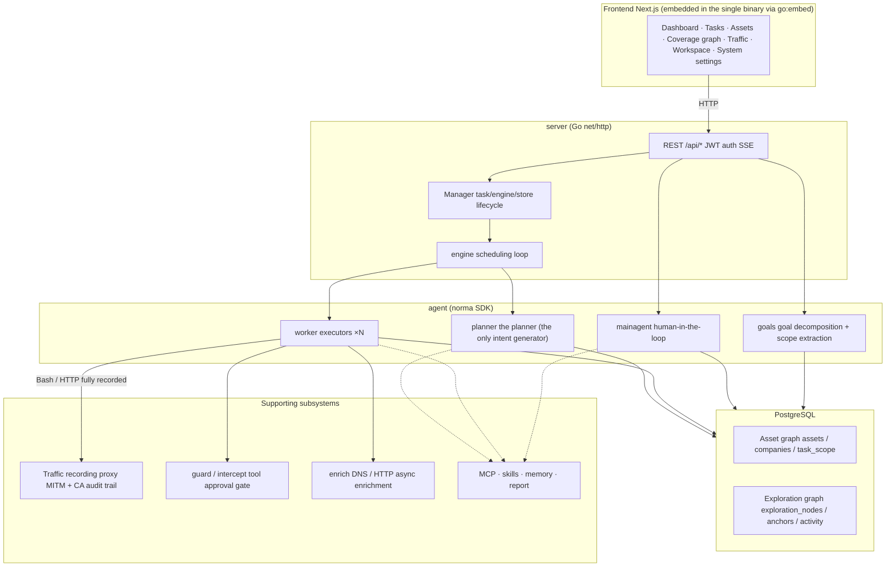
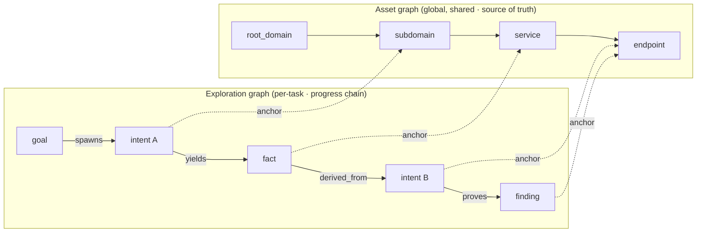
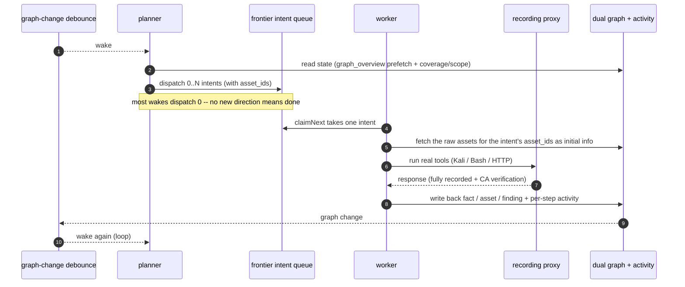
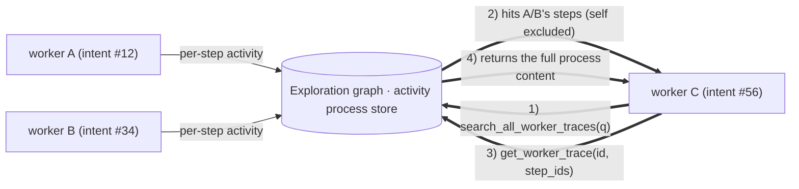
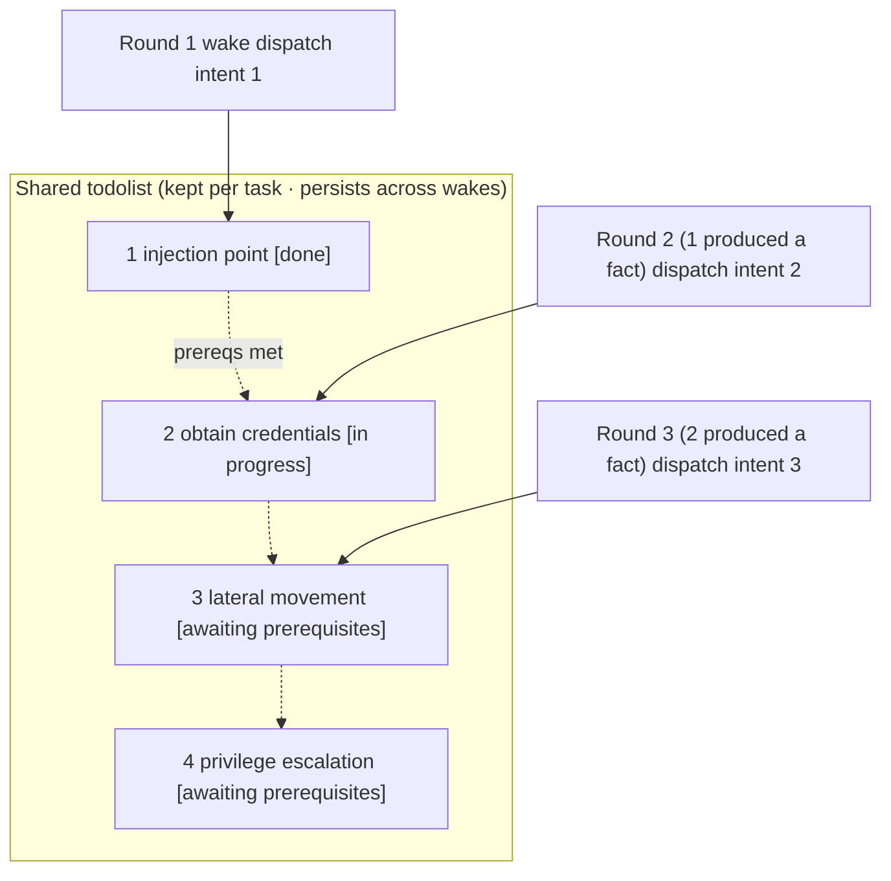

<div align="center">

# ARTEX

AI autonomous penetration testing system (Go backend + Next.js frontend)


🌐 **Live demo (mock data)**: [https://artex-demo.mhtsec.com](https://artex-demo.mhtsec.com)

📦 **This repository is a pure-source backup of the last version of ARTEX. The original Docker image `autumn27/artex` is gone; the image is now self-maintained by this repo as `mianhuatang11/artex` (Docker Hub). If pulling fails, you can build locally from pure source with `docker compose build`, with no external prebuilt dependencies.**

🌍 **This is an English fork of the original ARTEX repository. All Chinese UI text, comments, logs, messages, and documentation have been translated into English. Functionality is otherwise unchanged from upstream.**

</div>

---

## Screenshots

> For the full interaction, see the [live demo](https://artex-demo.mhtsec.com) (frontend-only + mock data, no backend required).

|| Dashboard (overview / token usage / activity stream) | Task list ||
| :---: | :---: |
||  |  ||

|| Task · execution process (sessions / tool calls) | Exploration chain ||
| :---: | :---: |
||  |  ||

|| Findings | Assets ||
| :---: | :---: |
||  |  ||

|| Asset coverage graph (force-directed layout · tested nodes highlighted · collapsible/expandable nodes) ||
| :---: |
||  ||

|| Traffic recording | Human-in-the-loop chat ||
| :---: | :---: |
||  |  ||

|| Agent management | LLM configuration ||
| :---: | :---: |
|  |  |

|| Intercept approval | Backend logs ||
| :---: | :---: |
||  |  ||


---

## Approval record details

The global "Approval records", the per-task "Intercept approval", and the approval cards in chat all support expanding to view details. The display structure is modeled on
[AegisHook's approval detail component](https://github.com/RuoJi6/AegisHook/blob/main/web/src/components/CallDetail.vue), reusing ARTEX's own components and theme:


## Asset sync (ScopeSentry)

You can sync asset data directly from [ScopeSentry](https://github.com/Autumn-27/ScopeSentry), avoiding duplicate collection:

- On the "**Asset sync**" page, enter ScopeSentry's address and API key to connect the data source;
- Select the targets and asset types to sync by **project** or **task** (domain / subdomain / IP / port / site / endpoint...);
- Import with one click and merge them by company asset scope, feeding directly into ARTEX's asset graph for agents to explore.

---

## Installation

> Requires a **PostgreSQL** database; exploration requires an **LLM** (`ANTHROPIC_API_KEY` or `OPENAI_API_KEY`, which can also be configured in the UI).

### Option 1: One-click install script (recommended)

```bash
git clone https://github.com/mhtsec/ARTEX.git
cd ARTEX
./install.sh
```

The script will: check / auto-install Docker -> let you choose **(1) all-in Docker** or **(2) local build and run**:

- **(1) All-in Docker**: enter a Postgres password (or press Enter for a random one) -> write `.env` automatically -> `docker compose up -d`.
- **(2) Run locally**: choose a database (connect to an existing one / start one with Docker) -> generate `config.json` -> build a single binary with `go` (embedded frontend) -> start.

Once installed, open **http://localhost:8787** (the first visit goes to `/setup` to set the admin password).

### Option 2: Docker Compose (manual)

```bash
git clone https://github.com/mhtsec/ARTEX.git
cd ARTEX
cp .env.example .env          # set POSTGRES_PASSWORD, and optionally ANTHROPIC_API_KEY
docker compose up -d          # pull the mianhuatang11/artex image + postgres
# → http://localhost:8787
```

> The original image `autumn27/artex` has been removed from Docker Hub; the image is now self-maintained by this repo as **`mianhuatang11/artex`**.
> If the image is unavailable (or you want to modify the code), just build locally from pure source: `docker compose build && docker compose up -d`.
> The Dockerfile is a multi-stage build (static frontend export -> Go static build -> runtime image), using China-friendly dependency sources by default; override with `--build-arg GOPROXY=... / --build-arg NPM_REGISTRY=...`.

The image already includes common tools (ripgrep/curl/vim/npm/nmap...); `./skills` and `./data` are persisted via bind mounts.

For remote MCP, you can choose `http` (Streamable HTTP) or `sse` (legacy SSE) in system settings.
Legacy SSE services typically establish an event stream with `GET /sse`, then receive JSON-RPC requests via the
`/message?sessionId=...` returned by the service; when configuring, set the URL to `/sse` and the header as
`Authorization=Bearer <token>`.

### Option 3: Download a prebuilt binary (Releases)

Download the zip for your platform from the original repo's [Releases](https://github.com/Autumn-27/ARTEX/releases) (**this backup repo does not host binaries**; if the original Releases are gone too, use Option 2 or Option 4). After extracting you get `artex` + `start.sh` (`start.bat` on Windows) + `skills/` + `config.example.json`:

```bash
cp config.example.json config.json   # fill in the database connection
./start.sh                           # → http://localhost:8787
```

> Launch with `start.sh` / `start.bat`, not `./artex` directly. It's a supervisor script: after the program exits it decides by exit code whether to restart, and **the in-page [one-click update](#option-1-in-page-one-click-update-recommended) relies on it to swap binaries**. If you run `./artex` directly, it won't be restarted after an update.
> Run persistently in the background: `nohup ./start.sh >artex.log 2>&1 &`.

### Option 4: Build a single binary from source

```bash
# 1) Static frontend export
cd web && npm ci && npm run build:static && cd ..
# 2) Copy into the embed directory
cp -r web/out server/webui/dist
# 3) Build (-tags embedui is required to embed the frontend)
CGO_ENABLED=0 go build -tags embedui -o artex ./cmd/artex
./start.sh
```

### Option 5: Build cross-platform release archives

`build.sh` first builds and embeds the frontend, then strips debug info with the Go linker and compresses the release files into zips. Release mode produces zips for Linux amd64/arm64, macOS amd64/arm64 and Windows amd64 by default:

```bash
./build.sh --release
# Output: dist/artex-0.3.3-*.zip
```

UPX self-extracting binaries may be incompatible with some Linux kernels, virtualization environments or security policies, so they're disabled by default. Use `ARTEX_TARGETS` to customize targets; when you're sure the target runtime is compatible, pass `--upx` explicitly to shrink the binary further:

```bash
ARTEX_TARGETS=linux/amd64,windows/amd64 ./build.sh --release
./build.sh --target linux/amd64 --upx
```

---

## Updating

> Upgrading only swaps the program, not the data: the Postgres volume `pgdata`, `./data` (jwt.key / SQLite, etc.) and `./skills` are all preserved. **No manual database migration is needed** -- `artex` idempotently re-runs `schema.sql` on every start (including `ADD COLUMN` / `CREATE INDEX IF NOT EXISTS`), so "restart = migrate". It's still recommended to back up `./data` and the database before upgrading.

### Option 1: In-page one-click update (recommended)

On the **System settings** page (sidebar "System settings" -> `/system/settings`), the **Version and updates** card lets you check for and install new versions directly, without logging into the server.

After clicking "Update": download the release package for the current platform -> verify against the release's `SHA256SUMS` -> smoke-test the new binary with `-h` -> stage it as `artex.new` -> the program exits and `start.sh` / `start.bat` restart it and complete the swap. The page waits automatically and refreshes once the new version is up.

- **A failure never leaves a broken program**: if verification or the smoke test fails, the staged file is discarded and the current version keeps running; if a newly swapped version fails to start 3 times in a row, it automatically rolls back to `artex.old` (the failed one is kept as `artex.failed` for troubleshooting).
- **Roll back anytime**: the previous version is kept as `artex.old`, and the card has a "Roll back to previous version" option. Note that the database schema is not rolled back.
- **Updating interrupts running tasks** -- updating means restarting, so do it during idle time.
- **Dev builds can't update**: disabled when the version is `dev` or when `git describe` has a suffix, to avoid a release overwriting a locally debugged binary.
- **Under Docker, only the program is swapped, not the image**: toolchains in the image like playwright / nmap are not upgraded, and recreating the container with `docker compose up -d` reverts to the version bundled in the image. To upgrade the image as well, use `docker compose pull artex && docker compose up -d artex`.
- If reaching GitHub needs a proxy, configure the **global proxy** on the same page and the update path will use it. Updates are downloaded only from GitHub domains and over enforced HTTPS.

### Option 2: One-click update script

```bash
cd ARTEX
./update.sh
```

The script first optionally runs `git pull` to fetch the latest code, then lets you choose **(1) Docker update** or **(2) local build update** (mirroring `install.sh`):

- **(1) Docker**: you can specify a target image tag (press Enter to keep `ARTEX_TAG` from `.env`, default `latest`) -> `docker compose pull` -> `docker compose up -d` (restarting with the new image migrates automatically).
- **(2) Local**: rebuild the static frontend -> recompile `./artex` (restart the process afterwards for it to take effect).

### Option 3: Docker Compose (manual)

```bash
cd ARTEX
git pull                       # update compose / scripts (optional)
# Pin a version: set ARTEX_TAG=v0.2.0 in .env; if unset, latest is used
docker compose pull artex
docker compose up -d artex     # restart with the new image -> schema migrates automatically
docker image prune -f          # clean up old images (optional)
```

### Option 4: Prebuilt binary (Releases)

Download the new version zip from [Releases](https://github.com/Autumn-27/ARTEX/releases), stop the old process, overwrite `artex` and `skills/` (keeping your `config.json` and `data/`), then restart:

```bash
cp -r <extracted-dir>/skills ./ && cp <extracted-dir>/artex ./
./start.sh
```

### Option 5: Build from source

```bash
git pull
cd web && npm ci && npm run build:static && cd ..
cp -r web/out server/webui/dist
CGO_ENABLED=0 go build -tags embedui -o artex ./cmd/artex
# restart ./start.sh
```

---

## Configuration

**Database** (`config.json`, or override with the env var `ARTEX_PG_DSN`):

```json
{
  "database": {
    "host": "127.0.0.1", "port": 5432,
    "user": "artex", "password": "yourpass",
    "dbname": "artex", "sslmode": "disable"
  }
}
```

**LLM**: `export ANTHROPIC_API_KEY=sk-...` (or `OPENAI_API_KEY`), or fill it in on the UI's "LLM configuration" page.
Optional: `ARTEX_LLM_PROVIDER` / `ARTEX_LLM_MODEL` / `ARTEX_LLM_BASE_URL` / `ARTEX_LLM_PROXY`.

**Concurrency**: the number of work agents per task is configured in "System settings" (default 3).

**Common flags**: `./start.sh -addr :8787 -proxy :8788` (`-addr` is frontend+API, `-proxy` is the traffic recording proxy). The launch script passes arguments through to `artex` as-is.

### Reverse-proxy deployment (HTTPS / expose only 443)

The frontend and API/SSE are served by the same backend port (default `:8787`), and the real-time activity stream uses the **same origin** by default, so **no `NEXT_PUBLIC_SSE_BASE` is needed**: expose only 443 publicly and keep 8787 on the internal network.

SSE is a long-lived connection with continuous push, so the reverse proxy **must disable buffering**, otherwise the browser connects but receives no events (the activity stream just spins). Nginx example:

```nginx
server {
    listen 443 ssl;
    server_name your.domain.com;
    # ssl_certificate / ssl_certificate_key ...

    location / {
        proxy_pass http://127.0.0.1:8787;
        proxy_set_header Host $host;
        proxy_set_header X-Forwarded-Proto $scheme;

        # SSE essentials: buffering off, long timeout, HTTP/1.1
        proxy_buffering off;
        proxy_cache off;
        proxy_read_timeout 3600s;
        proxy_http_version 1.1;
        proxy_set_header Connection "";
    }
}
```

> Only when SSE must use a different origin than the page (e.g. a separate subdomain) should you set `NEXT_PUBLIC_SSE_BASE` **at build time** (this variable is baked into the static bundle during `next build`, so setting it at container runtime has no effect).

---


## Development

### Manual vulnerability retesting

The "Retest" tab in task details lets you paginate through this task's vulnerabilities, review past conclusions and evidence, and manually trigger a retest. After starting, the current tab is kept, showing a spinner and "Retesting"; once a fix is confirmed, the vulnerability status is updated accordingly.

Click "Retest" in the per-row action area of the vulnerability list, or click "Start retest" in the "Vulnerability retest" section of the vulnerability details, fill in the optional fix version, test conditions or constraints, and the system creates a separate retest agent session, keeping the current page after it starts. The flat list, task-grouped and asset views all support this entry point; while a retest is running it shows a spinner and "Retesting", click to enter the corresponding session to view it, and once finished it returns to "Retest". A retest does not require restarting the original scan task; conclusions are one of "Still reproducible", "Fixed" or "Cannot confirm", and each conclusion, its evidence and the session link are saved in the vulnerability details.

On first start, the new backend seeds an editable "Vulnerability retest" (`retester`) agent, whose prompt, LLM, run budget and tools can be configured in Agent management. By default it uses its bound LLM, falling back to the globally active configuration if none is bound. When a retest session completes successfully with the conclusion "Fixed", the system automatically changes the vulnerability's disposition status to "Fixed"; running, failed, stopped or other conclusions keep the original status. The original evidence and reports are always retained. You can also manually select "Fixed" from the status dropdown. While a vulnerability is being retested, the existing session is reused, and it can be restarted after a stop, failure or service restart.

In this version the history is viewed through vulnerability details and sessions; it is not yet included in vulnerability report exports or task archive bundles, nor automatically linked to traffic captures. Demo mode only generates clearly labeled mock records and does not reach out to real targets.

### Running and testing locally

```bash
./dev.sh    # backend (:8787) + traffic proxy (:8788) + frontend next dev (:5173) -> http://localhost:5173
```

- Backend: `go run ./cmd/artex` (without `-tags embedui` the frontend is not embedded)
- Frontend: `cd web && npm run dev` (`/api` is reverse-proxied to the backend, with hot reload)
- Tests: `go test ./...`
- Mock preview (no backend): `cd web && NEXT_PUBLIC_MOCK=1 npm run dev`
- Redeploy the live demo (Cloudflare Pages, static export + mock data):
  ```bash
  cd web && NEXT_PUBLIC_MOCK=1 npm run build:static
  CLOUDFLARE_API_TOKEN=<token> npx wrangler pages deploy out --project-name=artex-demo --branch=main
  ```

---

## System architecture

ARTEX is an **LLM multi-agent-driven autonomous pentest system**: a Go monolithic backend (with an embedded Next.js frontend) + PostgreSQL, with agent capabilities provided by the [`norma`](https://github.com/Autumn-27/norma) SDK (`agentcore` / `tool` / `permission` / `harness` / `memory` / `transcript`). At its core is a **dual-graph architecture**, plus two autonomy mechanisms built around it: **process-level information exchange between workers** and **the planner's multi-round shared todolist for stable attack chains**.

### Overall layering



|| Layer | Responsibility ||
| --- | --- |
|| **Frontend** | Next.js static export, embedded into the single binary via `go:embed`; visualizes tasks/assets/exploration chains/coverage graph, human-in-the-loop chat ||
|| **server** | `net/http` routing + JWT auth + SSE; `Manager` owns the lifecycle of tasks, engines and DB stores ||
|| **engine** | One `plannerLoop` + N worker goroutines per task; intent claiming, timeout/pause/drain ||
|| **agent** | goals / planner / worker / mainagent; `ToolSet` exposes the dual graph as LLM tools ||
|| **db** | Postgres persistence of the dual graph (pgx); the schema is embedded via `go:embed` and idempotently creates tables on each start ||
|| **Supporting** | Recording MITM proxy, approval gate, async enrichment, MCP/skills/memory/reports ||

### Dual-graph architecture: exploration graph + asset graph

The system splits "**what the target is**" and "**how far testing has gone**" into two graphs that are independent of each other yet connected via anchors:

- **Asset graph (global, shared)**: a single cross-task source of truth for assets. Nodes are `root_domain / subdomain / ip / service / app / endpoint`, belonging to companies; the parent-child relationships domain->subdomain->service->endpoint and the dedup keys are all computed by the program, and the agent only submits raw information.
- **Exploration graph (per-task, independent)**: the "thinking and progress" process of a single task. Nodes are `goal / intent / fact / finding / hint`, connected by edges such as `spawns / derived_from / yields / proves` into a **lineage chain** that answers "which direction was derived from which facts, and what did it produce".
- **The two graphs are linked by anchors**: `exploration_anchors(node_id, asset_id)` anchors intents/facts/findings to concrete assets -- so you can see from an "exploration direction" which assets it targets, and from "a given asset" look up which intents tested it in this task and what facts were derived. This also powers **asset test coverage** and the **asset coverage graph** (in-scope assets + tested ones highlighted).



> Division of labor: the **planner** reads the exploration graph's state, judges the goal, and dispatches **intents** into the frontier only when there are new, uncovered directions; a **worker** claims **one intent**, executes it with real tools, writes new assets/facts/findings back to both graphs, and then stops. The asset graph is shared fact, the exploration graph is each task's progress chain.

### Engine and intent lifecycle (the loop of one exploration)

The engine is an **event-driven** loop: any graph change wakes the planner, the planner dispatches intents, workers claim and execute them and write back, and the write-back triggers the next round -- until the goal is proven (`prove_goal`).



### Process-level information exchange between workers

In a deep exploration, many valuable observations (an error, a response snippet, a hidden parameter) appear in one worker's **execution process** without necessarily being written up as a formal fact. To avoid duplicated effort and let workers along the chain stand on each other's shoulders, workers can **search across other works' processes**:

- `search_all_worker_traces(q)`: keyword search across **other works' execution processes in this task** (automatically excluding the steps of your own intent); hits carry `intent_id`;
- `list_worker_traces` / `get_worker_trace(intent_id, step_ids=[...])`: first see which works have run, then fetch the full content of a few specific steps of a work for a detailed exchange.

This way, even when the exploration graph has no corresponding fact yet, later workers can reuse others' in-process observations -- **information flows between workers at the granularity of the "execution process"**, while the boundaries stay fixed (each worker still only works on the single intent it claimed).



### The planner's multi-round shared todolist -> stable attack chains

A real attack chain is often a **multi-step sequence with ordered dependencies** (e.g. find an injection point -> obtain credentials -> move laterally -> escalate privileges), and dispatching all of these in parallel at once only causes chaos. The planner therefore keeps a **per-task, cross-wake shared planning todolist**:

- The planner is event-driven -- any graph change wakes it, but **each wake is a fresh session**; the shared todolist lets it **record a serial exploitation chain once** and then **dispatch intents step by step across later rounds by dependency**, rather than expanding the whole chain up front in a single round;
- Each round only dispatches an intent for the next step whose "prerequisite steps are done and whose required facts already exist", and updates the list as progress is made (marking steps satisfied by facts as done).



So even under "event-driven + stateless sessions", the attack chain still **progresses stably, without repetition or reordering** -- this is the key to ARTEX autonomously completing multi-step exploitation chains.

---

## Community group

Scan the QR code to follow the WeChat official account **SecSentry**, and send a direct message in the account to join the discussion group.

<div align="center">


</div>

---
## References

https://github.com/oritera/Cairn


## License and disclaimer

### Open-source license

This project is licensed under the **GNU Affero General Public License v3.0 (AGPL-3.0)**; see the [LICENSE](LICENSE) file in the repository root for the full terms.

This means anyone is free to use, modify and distribute this project, but **derivative works must also be open-sourced under AGPL-3.0**; in particular, **if you modify this project and provide it to users over a network (e.g. as a deployed online service), you must also make the corresponding complete source code available to those users**.

> ⚠️ **Important**: the open-source license itself does not restrict how the software is used. The "usage restrictions" and "disclaimer" below are additional terms and a solemn statement from the author to users; please abide by them.

**ARTEX is intended only for personal learning, code research and local technical verification, and must not be used to launch actual testing against any online system or website.**

### Permitted use

- May only be used to **read, study and research this project's source code**, and to verify technical principles in a **local, isolated environment**;
- Intended for non-offensive purposes such as personal learning, academic research and code review.

### Prohibited uses

- **Strictly prohibited: using this tool to launch scanning, probing, exploitation or attacks against any website, online service or networked system** (whether or not authorized, and whether or not it is your own asset);
- Strictly prohibited: using this tool for any actual penetration testing, red/blue team exercises or production environment;
- Strictly prohibited: using this tool for illegal intrusion, data theft, extortion, denial of service or any destructive or criminal activity;
- Strictly prohibited: using this tool to engage in any act that violates the laws and regulations of your country/region.

### Compliance responsibility

Users must comply with all laws and regulations of their country/region regarding cybersecurity, data protection and computer crime (in mainland China, including but not limited to the Cybersecurity Law, the Data Security Law, the Personal Information Protection Law and related judicial interpretations). **All legal liability and consequences arising from use of this tool are borne solely by the user.**

### Disclaimer

This project is provided "AS IS", without any express or implied warranty. The author and contributors are not liable for any direct or indirect loss, data loss, system damage or legal dispute resulting from use of this tool (whether or not used appropriately). **By downloading, installing or using this project, you confirm that you have read, understood and agreed to all of the above terms.**
