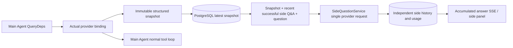

# ARTEX `/btw`

Normal chat, the task MainAgent, and the current task's own Worker all support independent side questions. Type `/btw <question>` in the main input box to submit; an empty `/btw` or the "Side Question" button opens the history. The desktop uses a resizable sidebar, and mobile uses a Drawer.

A side answer is generated from the Agent context snapshot at submission time, and supports streaming display, follow-ups, stop, and clear. Closing the panel, refreshing the page, or disconnecting SSE does not cancel the model request. Stop affects only the current side question; clear cancels the side question and deletes the side-question history, while preserving the main context snapshot.

## Implementation Boundaries

Reuses Go, norma v0.3.7, Next.js, and the existing Markdown / ResizablePanel / Drawer / AlertDialog components; it does not modify norma's source or add dependencies for side questions. Planner, Workers inherited from other tasks, and tool-type subtask escalation are out of scope this time.

- `capture.go` only tags main-loop requests at `Options.Deps.CallModel / CallModelSync`. The provider decorator sits inside the concrete model, after the routing pool's outer-layer selection, so it records the actually selected model; compaction and summarization requests do not overwrite the snapshot.
- Snapshots are published at request start, full model reply, and run terminal state. A half-finished reply still being generated is not published; tool calls stay paired via norma's `MessagesForAPI`, and tool results enter the snapshot at the next main model request or the run terminal state. A streaming abort keeps the last valid boundary.
- A snapshot preserves structured messages, the system prompt, tool definitions, and generation parameters via a JSON deep copy. Model inference does not hold a snapshot lock or a database transaction.
- `SideQuestionService` calls the concrete provider; when necessary it first generates a side summary, and the final answer may be retried once after reduction only when the context first overflows and no text/tool call has been output yet. It does not create an agent session, and does not connect to the tool executor, the main transcript, the activity stream, or the task graph, nor does it go through the task's model-switching chain. The answer retains tool definitions to stay compatible with existing structured tool context; summarization requests provide no tools. Newly returned tool calls have no execution path.
- One running request per parent session, at most four per service process, with a 120-second timeout per request. The side question uses an independent cancellation context under the service lifecycle.
- A side-question request keeps a reference to the model configuration and a non-sensitive identity summary; it obtains credentials from the existing configuration at request time. If the configuration is deleted, or identity fields such as the model, protocol, or address change, it requires running the main Agent first to update the snapshot. Tests do not change the product's default model.

## Persistence and Recovery

`db/schema.sql` automatically creates `side_question_sessions` and `side_question_requests`. The former stores the parent resource, the latest snapshot, run number, version, and cleanup version; the latter stores the question, accumulated answer, status, model, snapshot time, usage, event ordinal, and pagination ordinal.

The parent-session key uses the conversation ID, or the task ID + exploration ID + intent ID. Workers do not use reusable execution-slot naming.

Snapshots are merged and written per parent session, flushed every 250 ms, with the database comparing `(run_id, version)` to prevent an older version from overwriting a newer one. The selected snapshot is saved again before a side question is submitted. After a successful save, the large in-memory snapshot is released; on failure the pending version is kept. Accumulated answer content is written at most once every 250 ms as streaming events arrive, the terminal state is saved immediately, and there is a limited retry on database errors.

On service startup, leftover `running` requests are marked `interrupted`, keeping the already-persisted partial answer and usage, without automatically replaying the request. The most recently saved context can be used directly for the next question. When an old session has no snapshot, it requires running the main Agent first, and does not rebuild context from the UI activity log.

The clear operation increments the cleanup version and deletes the requests; a conditional update blocks a late callback from writing back. Physical parent-resource deletion relies on the foreign-key cascade, Worker logical deletion removes side-question data in the same transaction and rejects subsequent late snapshots. Task archiving first blocks new requests, waits for the main flow to stop, cancels and waits for side questions to persist; the archive format is v3, which stays compatible with v1/v2 that have no side-question tables.

History is fully preserved and returns at most 20 items per page via an ordinal cursor. A model request replays at most the verbatim text of the 20 most recent successful Q&A pairs, while limiting the replay volume by token budget; older Q&A maintains an independent rolling summary. When the main context exceeds budget, only the old part of the side copy is summarized, keeping recent structured tool calls and results. Summarization, preparation progress, and usage are all subject to the side question's concurrency, cancellation, and 120-second timeout limits. See [Context Budget and Open-Source References](CONTEXT_BUDGET.md) for details.

## HTTP Contract

The following paths serve as `{parent}`, reusing the existing authentication and resource validation:

- `/api/conversations/{id}`
- `/api/tasks/{id}/chat`
- `/api/tasks/{id}/intents/{iid}`

| Request | Response and behavior |
| --- | --- |
| `GET {parent}/side-questions?before={ordinal}` | `items` ordered newest to oldest, an independent `current` run status, `snapshot` metadata, `next_cursor`; a cursor of 0 means the latest page / no next page |
| `POST {parent}/side-questions` | JSON `{ "question": "…", "client_request_id": "UUID" }`; a new request returns 202 and the request object; the same ID and question returns the existing object with 200 |
| `DELETE {parent}/side-questions` | Cancels and clears the current parent session's side questions |
| `GET /api/side-questions/{requestID}/events` | `snapshot` SSE events, with `id` as an increasing ordinal and `data` as the full accumulated request object; sends `cleared` on clear |
| `POST /api/side-questions/{requestID}/cancel` | Explicit cancellation; the terminal state can be read from history or SSE |

The question limit is 4000 characters. No snapshot, a model configuration change, the same parent session busy, or an idempotency-ID conflict returns 409; the global concurrency cap returns 429. Each SSE connection first sends the accumulated state, without relying on text fragments the client received earlier. The frontend merges by request ID + ordinal, and discards old callbacks when switching parent sessions or clearing.

## Validation and References

See [VALIDATION.md](VALIDATION.md) for automated checks, real model usage, and known limitations.

For the standalone request, see [Grok CLI side-question.ts (pinned commit)](https://github.com/superagent-ai/grok-cli/blob/fb97af83f06dca873281d60168430f06c8de6324/src/utils/side-question.ts), and for run isolation see [OpenCode (pinned commit)](https://github.com/anomalyco/opencode/tree/b3f1a96c6dd7adeb28b36dd11add1998fc84d67b). ARTEX's context uses norma's structured messages, rather than concatenating text from frontend logs.
